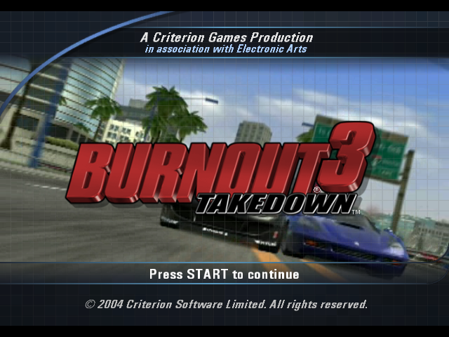
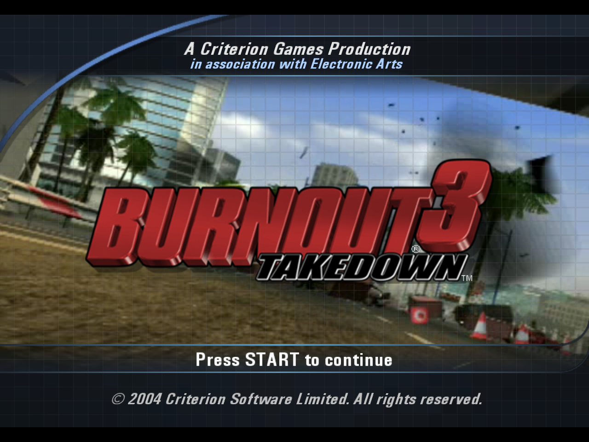
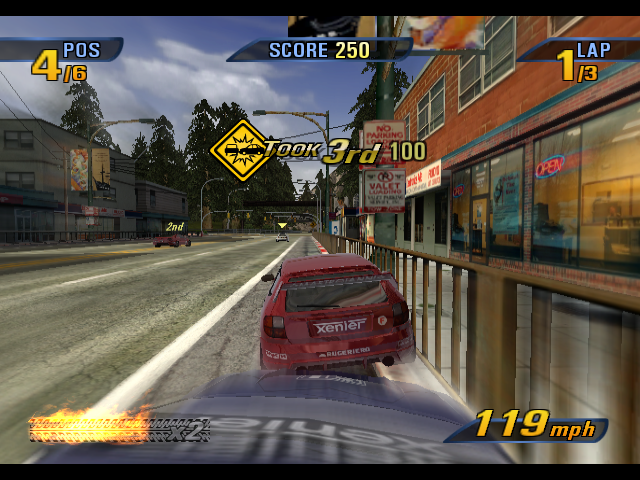
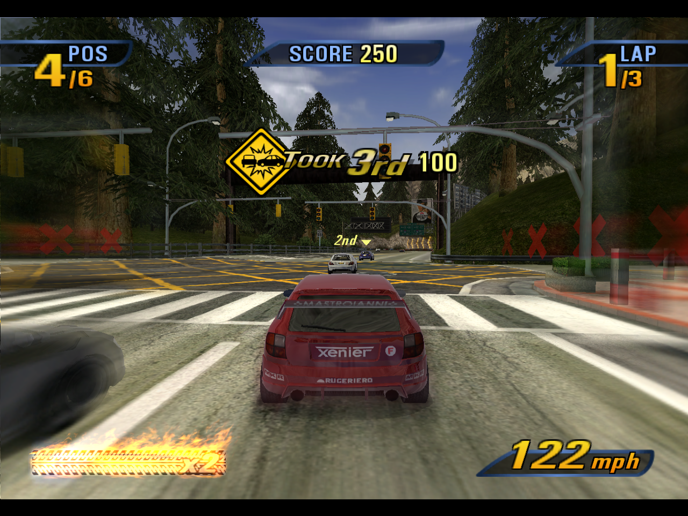

# Burnout 3: Takedown — static recompilation

A static recompilation of the Xbox version of Burnout 3: Takedown (Criterion, 2004)
into a native program for Windows, the Steam Deck and other Linux PCs (through
Proton) and macOS. The game's own x86 code is lifted to C by the
[xboxrecomp](https://github.com/sp00nznet/xboxrecomp) toolkit. It boots through
its real entry point and runs its own menus, races and renderer on the toolkit's
Xbox runtime. No game logic or screen is hand-written.

This is [apexJCL/burnout3-recomp](https://github.com/apexJCL/burnout3-recomp), a fork of
[sp00nznet/burnout3](https://github.com/sp00nznet/burnout3) by sp00nz, which keeps
upstream's history and build. The fork builds the game through
[xboxrecomp-cli](https://github.com/apexJCL/xboxrecomp-cli) against the toolkit fork
[apexJCL/xboxrecomp](https://github.com/apexJCL/xboxrecomp), which adds Direct3D 11
and Metal renderers, a macOS host and an options file; it publishes a build
wizard for players in its [releases](https://github.com/apexJCL/burnout3-recomp/releases).

**Generated source is not distributed.** The repository holds the build glue, the
per-title data and the docs. You supply your own disc image; the recompiler runs
on your machine and writes the C into a gitignored folder.


*Two-player split-screen, recorded headless with `--record`-style per-flip frames and scripted pads.*

## Progress

Every game mode boots, renders and plays, one or two players, driven by a
controller. On this fork the GPU runs on Direct3D 11 or Metal, so races run at
full speed; on upstream's toolkit, with the NV2A emulated in software, menus run
at about 14 fps and races at 2–4 fps.

| You play on | Bundle | Graphics | Audio | Input | Status |
|---|---|---|---|---|---|
| Steam Deck (stock SteamOS), or a Linux gaming PC | `steamos` (the Windows build, run under Proton through `umu-run`) | Direct3D 11 (DXVK) | XAudio2 (FAudio) | Controller (XInput), two pads | Plays, in one window. The Deck is the regular test machine: a scripted race runs at about 57 frames a second. Fullscreen is off by default: add the game to Steam with the Gamepad template (the bundle's README says how). |
| macOS (Apple silicon) | `macos` (`.dmg`) | Metal | SDL2 (CoreAudio) | Controller (SDL GameController) and keyboard | Plays: the same scripted race runs at about 55 frames a second. The title screen and menu music is silent. |
| Windows x86-64 | `windows` (a setup program) | Direct3D 11 | XAudio2 | Controller (XInput), two pads | Builds and installs. On native Windows 11 it has been checked to start in one window and reach Press START; it is played and tested under Proton. |

The game runs at its own frame rate and 4:3, as on the Xbox. Render scale 2 to
4 draws it sharper on Direct3D 11 and Metal (`[render] scale` in
`config/config.toml`, or the wizard's Render scale).

This build on Metal (macOS), at render scale 1 and 2:

| Scale 1 (640x480) | Scale 2 (1280x960) |
|---|---|
|  |  |
|  |  |

**Sister project:** [BLiNX 2 recomp](https://github.com/apexJCL/blinx2-recomp)
([releases](https://github.com/apexJCL/blinx2-recomp/releases)), on the same
toolkit fork and CLI; its README tracks its progress the same way.

**What is published, and what never is.** This repository holds the build glue,
the per-title data, the docs, upstream's screenshots and a few images of this
build for this README. Game files, the code generated from them, frame dumps,
audio captures and saves are never published, and a release carries only the
wizard, which builds the game from your own disc on your machine.

Modes, as upstream recorded them:

| Mode | Players | Status |
|---|---|---|
| Race (Single Event) | 1 | plays to the finish |
| Time Attack | 1 | plays |
| Road Rage | 1 | plays |
| Crash | 1 | plays: launch, pile-up, score |
| Race | 2, split-screen | plays |
| Road Rage | 2, split-screen | plays |
| Double Impact | 2, split-screen | plays |
| Team Crush | 2, split-screen | plays |
| Party Crash | 2–8, pass the pad | plays |
| Xbox Live / System Link | — | not attempted |

Known gaps, as upstream lists them for its toolkit: vertical streaks over the menu
backdrop movie, seams in the sky dome, bump-mapped (dot-product) texture stages
read as zero, and no profile saving (so the tutorial video plays every launch;
see [docs/running.md](docs/running.md)).
[ROADMAP.md](ROADMAP.md) has the list; [docs/boot.md](docs/boot.md) has what it
took to get here, fix by fix.

This is one title in the xboxrecomp family and follows its house style: the
toolkit carries everything that isn't specific to Burnout 3, and this repo carries
only what is.

## Play it: the build wizard

Each [release](https://github.com/apexJCL/burnout3-recomp/releases) carries a small
program for Windows, macOS and Linux (Steam Deck included): download yours,
point it at your own Burnout 3: Takedown disc image, pick the render scale and
whether to start fullscreen, and it builds and installs the game for you. It runs
the same `./burnout3` commands as [Building with ./burnout3](#building-with-burnout3-xboxrecomp-cli)
below. Nothing from the game is downloaded: the only game data used is your disc
image, and the build stays on your machine.

On a Steam Deck the game starts in a window. In Desktop Mode, add it to Steam
(the installer's `--steam` does this), pick the Gamepad template in its controller
settings and start it from Steam; quit from the pad with the Steam button, then
Exit game.

## Screenshots

Upstream's, taken on its software renderer:

| | |
|---|---|
|  |  |
| A takedown: slam a rival into a pillar | A single race, off the line |
|  |  |
| Crash mode: the junction pile-up | Race |
|  |  |
| Road Rage | Double Impact (2P) |
|  |  |
| Crash mode scoring | Time Attack |
|  |  |
| Vehicle select | Crash junction map |

More in [docs/screenshots](docs/screenshots).

## Getting Started

Upstream's route: Windows with Visual Studio 2022 and upstream's toolkit,
unchanged in this fork. You need:

- Windows 10 or 11, x64, with about 12 GB free
- your own Burnout 3: Takedown disc image (`.iso`)
- an Xbox or XInput controller (two for split-screen); there is no keyboard mapping

### Quick start

1. Download this repository (green **Code** button, **Download ZIP**) and unzip it
   somewhere with space, for example `C:\recomp\burnout3`.
2. Double-click **`Setup.cmd`**.

   It checks for Python 3.10+, the capstone package, Git, CMake and the Visual
   Studio 2022 C++ build tools, and asks before installing any that are missing
   (with winget), saying what each is and how big. It fetches the xboxrecomp
   toolkit beside the repo folder, then asks for your `.iso` (it looks next to the
   repo and in Downloads first). After that it unpacks the disc, regenerates the C
   and builds.

   Each step is skipped once done, so after a failure just run it again. What went
   wrong goes in `setup.log`, and the window says what to do next.
3. Double-click **`Play Burnout 3.cmd`**, which the setup leaves in the repo folder.

The first build takes 20–40 minutes. Nothing from the game is downloaded or
bundled: the only game data used is your disc image.

### Step by step

The same steps as `Setup.cmd`, by hand. Commands are for PowerShell, except where
the step says Git Bash.

1. **Install the prerequisites.**

   | Tool | Version | Get it |
   |---|---|---|
   | Python | 3.10 or newer, with the `py` launcher | `winget install -e --id Python.Python.3.12` |
   | capstone | 5.x | `py -3 -m pip install --user capstone` |
   | Git for Windows | any recent, which includes Git Bash | `winget install -e --id Git.Git` |
   | CMake | 3.20 or newer | `winget install -e --id Kitware.CMake` |
   | Visual Studio 2022 | Build Tools with *Desktop development with C++* | `winget install -e --id Microsoft.VisualStudio.2022.BuildTools` |
   | ffmpeg | optional, for `--record` | `winget install -e --id Gyan.FFmpeg` |

   Open a **new** terminal afterwards so PATH picks them up. If `python` opens the
   Microsoft Store, that's the Store alias; use `py -3` as below, or turn the alias
   off under *Settings → Apps → Advanced app settings → App execution aliases*.

   ```
   > py -3 --version
   Python 3.12.10
   > cmake --version
   cmake version 3.31.6
   ```

2. **Put the repo and the toolkit side by side.** The build looks for the toolkit at
   `..\xboxrecomp`.

   ```
   git clone https://github.com/sp00nznet/burnout3
   git clone https://github.com/sp00nznet/xboxrecomp
   ```

   The toolkit's `main` has everything Burnout 3 needs (xboxrecomp #138-#156).

3. **Unpack your disc image** into `burnout3\Burnout 3 Takedown\`, using the
   toolkit's XDVDFS reader:

   ```
   cd xboxrecomp
   py -3 -m tools.xiso unpack "D:\isos\Burnout 3 - Takedown (USA).iso" -o "..\burnout3\Burnout 3 Takedown"
   cd ..\burnout3
   ```

   You should end up with `Burnout 3 Takedown\default.xbe` next to `Data\`,
   `Tracks\`, `ovid\` and the rest (about 2.4 GB).

4. **Regenerate the C** (Git Bash, from the `burnout3` folder):

   ```
   $ ./regen.sh --disasm
   ==> xbe_parser
   ==> disasm
   ==> func_id
   ==> abi_analysis
   ==> recomp
   ==> done. Now: cmake --build build-xr --config Release
   ```

   This writes `src/game/recomp/gen/`, about 29 files, all gitignored.

5. **Build** (PowerShell or Git Bash):

   ```
   cmake -S . -B build-xr -G "Visual Studio 17 2022" -A x64
   cmake --build build-xr --config Release --parallel 2
   ```

   It ends with `burnout3.vcxproj -> ...\burnout3\bin\burnout3.exe`. `--parallel 2`
   together with the default `/MP` (half your cores) keeps the machine usable while
   it compiles. Each generated file is large at `/O2`.

6. **Run** it from the repo folder, so it finds `Burnout 3 Takedown\` and `saves\`:

   ```
   .\bin\burnout3.exe
   ```

   A window opens titled `Burnout 3: Takedown | FPS: n | draws: n`, and you see the
   EA and Criterion intros, then "Press START".

**Usual trip-ups:** `regen.sh` needs Git Bash, not WSL's `bash`. A tool installed a
moment ago isn't found until you open a new window. The build needs the
64-bit generator (`-A x64`).

### Building with ./burnout3 (xboxrecomp-cli)

This fork also builds through
[xboxrecomp-cli](https://github.com/apexJCL/xboxrecomp-cli), the command line
the [BLiNX 2 recomp](https://github.com/apexJCL/blinx2-recomp) uses. It is the
path this fork tests: a Windows x86-64 exe cross-compiled with llvm-mingw
(from macOS or Linux as well as Windows) and run under Proton on Linux, and a
native macOS build on Metal, against the toolkit fork (`apexJCL/xboxrecomp`) at
the commit `game.toml` pins. Upstream's `Setup.cmd`, `regen.sh` and Visual
Studio build above are unchanged.

You need [uv](https://docs.astral.sh/uv/), git and Python 3. `./burnout3`
(`burnout3.cmd` on Windows) finds or clones the CLI at its pinned commit and
runs it; `game.toml` holds everything it knows about this game.

```
./burnout3 setup        # the tools venv (.venv), llvm-mingw, the toolkit at its pin
./burnout3 doctor       # what this host has
./burnout3 analyze      # xbe_parser, disasm, func_id, abi_analysis -> build/xr/
./burnout3 recomp       # the C, into src/game/recomp/gen/ (the same files regen.sh writes)
./burnout3 build        # build-win/burnout3.exe; `build macos` on a Mac: build/burnout3
./burnout3 bench ...    # build and run it under Proton on a Linux host (docs/running.md)
./burnout3 package windows   # dist/: an installer folder for Windows
./burnout3 package steamos   # dist/: one .tar for a SteamOS-like Linux PC (Proton through umu-run)
./burnout3 package macos     # dist/: a .dmg with Burnout3Takedown.app (on a Mac)
./burnout3 wizard build --dev   # the player wizard from this tree (docs: the CLI's docs/wizard.md)
```

The disc is read from `Burnout 3 Takedown/`, as above; nothing is written
into it. A `../xboxrecomp` checkout beside this one is used as it is
(`XBOXRECOMP_DIR` names another), like a `../xboxrecomp-cli` checkout for the
CLI (`XBOXRECOMP_CLI_DIR`).

`./burnout3 package` (with no target: `windows`) builds a stock exe in its own
`build-pkg-win/` and wraps it with a launcher, your game files and a README
into a private bundle in `dist/`. The bundle holds your copy of the game:
it is for your own machines, never to share. The launcher renders through
Direct3D 11 (`RECOMP_PB_BACKEND=d3d11`); settings and saves live outside the
program, in `%LOCALAPPDATA%\Burnout3Takedown` on Windows and
`~/Games/Burnout3Takedown` on Linux, and survive updates. The bundle's
`README.txt` has the install steps.

## Usage

```
bin\burnout3.exe [--headless] [--record out.mp4] [--seconds N] [path\to\default.xbe]
```

| Invocation | What it does |
|---|---|
| `burnout3.exe` | Plays in a window. Pad 1 and pad 2 are XInput pads 1 and 2. |
| `burnout3.exe --headless` | Runs with no window, for scripts and remote sessions. |
| `burnout3.exe --headless --record out.mp4 --seconds 600` | Runs for 10 minutes with no window, then encodes every presented frame to `out.mp4` (needs `ffmpeg` on PATH). Ctrl+C also stops and encodes. |

Scripted input, for recording or testing without a pad in hand:

```
set RECOMP_PAD_SCRIPT=20000:start:1200,30000:a:400,90000:rt:60000,90000:p2-rt:60000
bin\burnout3.exe --headless --record race.mp4 --seconds 900
```

Each entry is `<ms>:<button>[+<button>][:<hold ms>]`, timed from when the game first
reads the pad, and a `p2-` prefix sends it to the second pad. `RECOMP_PAD_LIVE=pad.txt` instead reads steps appended to a file while the
game runs. [docs/running.md](docs/running.md) lists the buttons, the environment
variables and the capture tools.

The emulated hard disk lives in `saves\`. Delete it to see the first-boot flow
(profile creation) again.

## Building from source

`regen.sh` runs the toolkit's pipeline on `default.xbe`. The stages are XBE parser,
disassembler, library-function identification, ABI analysis and the recompiler.
CMake then builds the generated C against the xboxrecomp runtime. That runtime
supplies the Xbox kernel, a software NV2A GPU, the MCPX audio processor, a USB
OHCI host with emulated pads, and the XMV movie player. See
[docs/architecture.md](docs/architecture.md) for which part owns what.

The C is regenerated, not edited. If the output is wrong, the fix goes in the
toolkit's recompiler or in this repo's per-title data
(`config/seed_functions.json`, `src/game/main.c`), never by hand in `gen/`.

The exe is a Windows GUI-subsystem program, so it opens no console window
beside the game. Started from a terminal, `cmd` no longer waits for it and
its output goes nowhere: set `RECOMP_STDIO_LOG=<file>` (fork toolkit) to keep
the log, or configure with `-DBO3_CONSOLE=ON` to build the console program,
which prints to the terminal as before (needed for Ctrl+C to stop a
`--record` run).

## Contributors

See [CONTRIBUTORS.md](CONTRIBUTORS.md). Contributions are welcome; read
[CONTRIBUTING.md](CONTRIBUTING.md) first, especially *Where your code comes from*.

## License

MIT, see [LICENSE](LICENSE). This covers the code in this repository only.
Burnout 3: Takedown and its assets belong to their owners and are not included.
No game files, code generated from them, frame dumps, audio captures or saves
are published here or in a release; the wizard and `./burnout3 package` build
from your own disc on your machine, and a bundle holds your copy of the game:
it is for your own machines, never to share. This project is not affiliated
with the game's owners.
